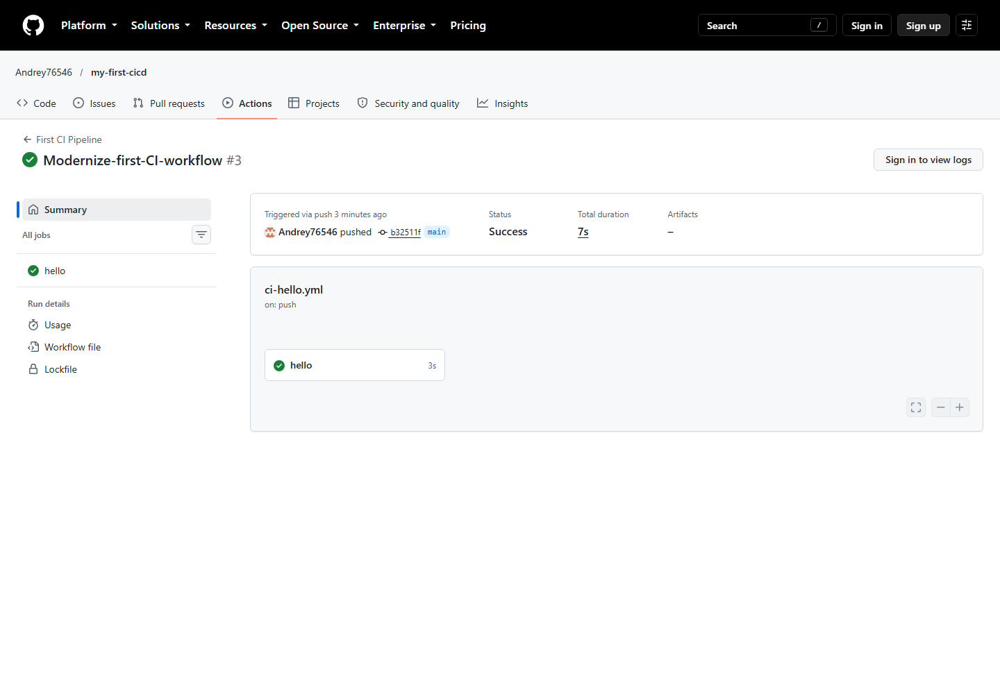

# Лабораторная работа 1. Первый CI pipeline

## Цель работы

Настроить базовый pipeline GitHub Actions и подтвердить его успешное выполнение при изменениях в репозитории.

## Что сделано

- Создан workflow [`ci-hello.yml`](.github/workflows/ci-hello.yml).
- Настроены запуски для `push` и `pull_request` в ветку `main`, а также ручной запуск `workflow_dispatch`.
- Задача `hello` выполняется на фиксированном образе `ubuntu-24.04`.
- Репозиторий загружается актуальным действием `actions/checkout@v7`.
- В журнал выводится контрольное сообщение: `Привет, мир! Я только что запустил CI!`.

## Как запускать / проверять

1. Отправить коммит в ветку `main` или открыть pull request в `main`.
2. Либо открыть вкладку **Actions**, выбрать **First CI Pipeline** и нажать **Run workflow**.
3. Убедиться, что workflow имеет статус **Success**, а задача `hello` отмечена зелёной галочкой.

## Результат выполнения

[First CI Pipeline #3](https://github.com/Andrey76546/my-first-cicd/actions/runs/39559397509) успешно завершён: задача `hello` выполнена на `ubuntu-24.04`.

## Скриншот

## Ссылка на workflow / Actions

- [Файл workflow](.github/workflows/ci-hello.yml)
- [Все запуски First CI Pipeline](https://github.com/Andrey76546/my-first-cicd/actions/workflows/ci-hello.yml)
- [Подтверждённый успешный запуск](https://github.com/Andrey76546/my-first-cicd/actions/runs/39559397509)
